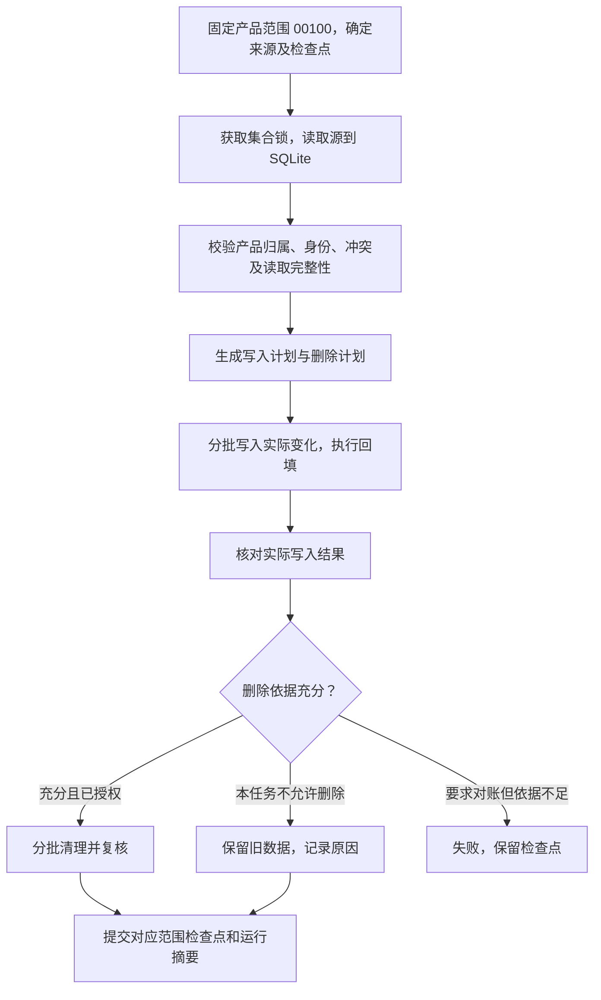

# 数据同步优化方案与实施计划

> **For Claude:** REQUIRED SUB-SKILL: Use superpowers:executing-plans to implement this plan task-by-task.

**Goal:** 所有正式同步数据固定限定在 `PRODH_LIST=["00100"]`，消除该范围内的误删和覆盖路径，保留历史更正能力，减少重复读取、写入和内存占用。

**Architecture:** 保留现有 Python 脚本、MongoDB、SQLite 快照和串行编排。将来源范围、读取完整性、删除授权和检查点提交明确分开；订单参考数据使用完整明细和保守匹配；性能优化以批次、分片和可恢复的增量传播为主。

**Tech Stack:** Python、现有 PyMongo/httpx、标准库 SQLite/HTMLParser、pytest。初期不引入新服务或消息中间件。

---

日期：2026-10-27。状态：代码已实施，验证和实施决定见同目录 `2026-10-27-sync-optimization-progress.md`；尚未执行真实同步或存量迁移。依据 `docs/同步脚本评审-2026-10-27.md`，仅涉及同步脚本及直接调用的清洗、回填模块。保留工作区已有修改。

用户已明确：所有数据必须限定 `PRODH_LIST=["00100"]`。该约束覆盖所有同步入口、直接执行的维护入口、全量、增量、历史核对和下游回填，优先于旧方案中允许 ALL/多产品范围的设计。存量其他产品的数据不属于最终保留范围。

## 1. 方案选择

| 方案 | 优点 | 代价 | 建议 |
| --- | --- | --- | --- |
| 保留现有入口，先修数据安全，再逐项减负 | 改动边界清楚，易逐步验证，兼容现有执行方式 | 需要明确范围和恢复契约 | 采用 |
| 立即重构成统一同步框架 | 形式上集中配置 | 不同来源语义差异大，容易把错误规则统一扩散 | 暂不采用 |
| 所有任务改为只增不删，并增加并发 | 可快速压低部分误删概率 | 陈旧数据持续累积，重复请求和写入未解决，并发增加源压力 | 仅将无法证明安全的删除临时关闭 |

优先级为：数据正确性、失败可恢复、性能、代码精简。小入口文件和不同作用范围的锁不是本轮主要冗余。

## 2. 总体流程



多批次写入仍不承诺整窗口原子性。阶段失败会留下已完成的 upsert，但后续删除和对应检查点提交停止；重跑重新校验并幂等恢复。暂不通过整表替换或影子集合切换改变读端架构。

### 2.1 四项分别判定

| 项目 | 含义 | 不能被什么替代 |
| --- | --- | --- |
| `read_complete` | 本次请求都完成，格式、业务键、窗口校验通过 | HTTP 200 |
| `coverage_verified` | 来源契约能证明目标候选范围已被完整覆盖 | 短页、记录总数、日期看起来覆盖全年 |
| `cleanup_authorized` | 本次明确允许对该范围删除 | `--full` |
| `write_verified` | 实际写入与计划一致，未发生匹配不足或部分失败 | bulk_write 未抛异常但未检查结果 |

快照完成只代表源读取阶段完成。删除必须同时满足这四项、有效租约及数量保护。`--allow-large-cleanup`、`--confirm-delete` 仅放宽数量限制，不越过来源完整性、范围、业务键或锁校验。

初期将校验和删除计划放入 `scripts/sync_runtime.py`，由各来源提交明确的范围和证据；不先设计插件框架。新增摘要字段保持兼容现有 `success`，不要求修改其他业务代码。

### 2.2 固定产品范围与检查点

产品范围是业务约束，不再是可以放开的优化选项。使用一个共享定义和校验函数，每次请求创建新的列表值：

```python
REQUIRED_PRODH = ("00100",)

def required_prodh_list() -> list[str]:
    return list(REQUIRED_PRODH)
```

- SAP 销售订单和状态接口始终显式发送 `{"PRODH_LIST": ["00100"]}`，不允许省略、空列表或其他值。
- 删除 `--all-prodh` 的实际放开能力；为避免旧命令静默扩大范围，旧参数明确报错。`--prodh-list` 和 `SOURCE_PRODH_LIST` 若保留兼容，只接受与 `["00100"]` 完全一致的值，冲突时请求前失败。
- 不以 `startswith("00100")`、公司分类、默认配置或调用方承诺代替产品归属证明。源字段若是更长的产品层次编码，先确认源接口对 `PRODH_LIST` 的匹配语义。
- 接口不返回产品字段时，必须确认接口会执行该过滤契约；请求里带参数本身不构成结果已过滤的证明。没有可信契约或关联证据的数据进入待核对流程，不能伪造 PRODH 入库。

不同来源的准入方式：

| 数据 | 范围证明 |
| --- | --- |
| 销售订单及历史状态 | 经确认有效的固定产品过滤接口；读取和目标明细校验使用同一范围 |
| 工位、维修 | 源可可靠按产品过滤时直接过滤，否则以来源兼容的生产订单或主机身份关联已验证的 00100 参考快照 |
| BOM | 按主生产订单/主产品归属确认 00100；BOM 中的零部件关系不因部件自身产品层次不同被盲目丢弃，CPX 规则另外保持 |
| 序列号绑定 | 核实 PRODH 字段语义后按主产品范围准入，必要时使用主订单/主机关联；明细部件的字段不能替代主产品归属 |
| SCS DOA、换上换下 | 列表先暂存，按详情中的可信订单/主机关系关联 00100 范围；换上换下须对应已验证的归属，`is_5000_company` 不能代替产品准入 |

源接口不支持过滤时，允许临时读取较大结果集用于筛选，但只允许已确认属于 00100 的记录进入正式业务集合。未知、歧义或关联缺失记录单独待核对，并保留可重试身份和所需内容，不能随列表水位推进永久丢失。预览不得写持久化待处理数据。

运行摘要分别统计 `fetched`、`in_scope`、`out_of_scope` 和 `scope_pending`。快照覆盖数量核对和删除候选只使用相同 00100 范围，不能用包含其他产品的原始抓取数量抵消空范围保护。待核对内容未可靠持久化时不得推进对应读取水位；核验后重试正式写入或确认范围外。

销售检查点由当前仅按来源，改成按来源和过滤契约隔离：

```text
scope_id = hash(canonical_json({
    dataset, source, source_client, method,
    prodh_list=["00100"], scope_rule_version, schema_version
}))
checkpoint_id = sales_orders:{source}:{scope_id}
```

日期是每次运行的覆盖区间，不直接作为日常增量检查点的身份；历史分片另保存游标。历史 ALL/其他产品水位不能直接用于新的 00100 范围，也不继续提供多产品模式。

旧检查点缺少过滤信息时，不自动认定为 00100。迁移先列出旧水位和来源证据，只有原运行记录足以证明已完整覆盖 00100、且读取和写入语义兼容时才继承，否则对 00100 范围补跑；旧检查点保留以供核对。

源查询日期 CHDAT 与 GSTRS 未证明等价，不能按 GSTRS 反推清理范围。一个生产订单可能包含多个产品层次，也不能仅按代表行 PRODH 删除整单。

## 3. 第一阶段：先消除误删和错误匹配

### 3.1 统一完整订单明细的匹配

新增轻量模块 `scripts/sales_order_reference.py`，只负责已验证 00100 明细的遍历、候选集合和歧义判断，供工位、维修、BOM 及其他来源归属判断调用。范围准入的共享定义放入 `scripts/sync_runtime.py`，独立入口也必须执行。

规则：

1. 非空 `records` 是明细主体；`data` 仅补充尚未被同身份明细覆盖的历史兼容行。相同身份字段冲突必须报告，不能用代表行覆盖。
2. 只有 `data` 的旧文档在产品归属已验证后仍可读取；有明细但字段缺失时，不借代表行悄悄补成唯一候选。未完成产品核验的存量不进入可信参考索引。
3. 身份保留来源、客户端和原始订单号；规范化仅用于受控候选匹配。去零后发生碰撞、跨 SG/KK 无法区分、或目标来源未知且存在多种匹配时，返回 ambiguous。
4. 多条明细对应多个 VBELN 或多个 GSTRS 时，保持多值。明确唯一且来源兼容时才自动回填；生产订单与销售订单都已提供时，先校验组合。
5. “存在于参考明细”可以证明某个正向匹配；“未出现在参考明细”不能独立证明工位记录无效。

工位停止按“本地订单缺失”硬删除，改为摘要中的 `unresolved_reference`。已知属于 00100 但参考不完整的存量保留；新记录归属未知时暂存待核对，不进入正式集合。未知存量在迁移中单列，不能将“匹配不到”直接判为非 00100。只有产品归属或另有业务删除依据已核实，才生成对应清理计划。

参考索引在销售数据完成有效同步后构建。构建时持有销售集合锁或使用已发布的不可变参考快照；不能只凭一个历史成功 run_id，就认为当前原地更新中的数据仍完整。所有多集合锁按固定顺序获取，避免目标锁与参考锁嵌套形成死锁。

### 3.2 销售全量的安全默认值

- `--full` 表示完整读取指定日期窗口并更新，默认不再按本次未返回直接清理整个集合。
- 原 `--replace-collection --confirm-delete` 不再仅凭日期放行：先证明来源覆盖整个替换范围，再逐来源检查候选。当前接口契约未证明前拒绝该操作并给出原因。
- SG/KK 独立校验现有数量、空返回、来源范围和删除量。一方空返回不能被另一方的数据抵消。
- 有本地数据的来源突然空返回时，阻断破坏性对账，不推进该对账检查点。初期仍维持现有总体成功门槛，不顺带改变编排依赖语义。
- 请求产品范围始终是 00100；全量、整表替换和数量确认均不能放开该限制。
- 存量已确认非 00100 的记录进入一次性范围迁移清理；未知归属先核验，不能由本次“未返回”直接推断。混合产品订单按明细保留 00100 行并重新计算代表行和汇总，不能只看代表行删除整单。

数量保护保留，但先验证范围，再计算同一来源、同一范围内的候选数量。少于 100 条也必须满足完整性条件。

范围外存量清理与“00100 源记录已消失”的日常对账是两类计划，分别报告依据。前者可依据可信的非 00100 归属证据清理，不要求它出现在本次 00100 源响应中；后者仍必须证明来源完整性。迁移完成前明确报告未完成，不能宣布所有存量均已满足新约束。

## 4. 第二阶段：解决来源完整性和详情失真

### 4.1 销售按单聚合，确认跨窗语义

销售读取也先落入 SQLite，完成产品准入和该次来源快照校验后才写目标。分窗不再直接覆盖 MongoDB 整单。跨窗合并、读取旧目标补齐明细时均不得把非 00100 的旧行带回正式结果。

SAP 契约确认前采用以下分支：

| 接口实际语义 | 写入方式 |
| --- | --- |
| 每次返回订单全部当前明细 | 验证按单完整性；按可靠源版本选择整单，不能仅用请求先后当作版本 |
| 返回日期窗口内局部明细 | 跨窗按稳定明细键合并，计算去重后的数量；增量只合并或修正返回行，不凭缺行删除旧行 |
| 明细键或返回语义未确定 | 不实施整单破坏性覆盖；同键不同内容且无可靠版本依据时失败，保留目标 |

现有 `MANDT/AUFNR/VBELN/POSNR/ETENR/MATNR` 只能作为待验证的明细键候选。接口负责人或只读样本需证明其唯一性和变更规则。不能简单累计窗口数量，也不能默认取最后一行。

第一阶段可以独立上线。遇到上述不明确情况，先阻断受影响订单写入或整个范围任务，保留旧值并报告，不继续使用已知会覆盖明细的路径。

### 4.2 SCS 分页和删除

- 记录分页请求、业务键、重复页指纹及预期页大小；重复整页或异常页结构应失败。
- 优先核实源是否支持一致性查询令牌、稳定快照或明确删除记录。稳定排序和普通键集分页本身也不能证明任意变化记录已被完整读取。
- 没有完整性依据时，全量列表用于更新，自动物理删除关闭；报告缺失候选。
- 多次没看到、总数相同或两次扫描一致只能作为诊断信号，不能自动升级为删除证明。必须有可信的按键不存在查询、源删除事件或明确人工核实结果，才恢复该类清理。
- 预览和正式执行使用相同计划规则。正式执行重新验证条件，不能直接信任过期预览。

代价是来源已删除但尚未确认的记录暂时保留；这是显式的待核对状态，运行摘要必须显示，不能声称已完成严格全量对账。

### 4.3 DOA 详情

- full 强制刷新本次待核验或已确认属于 00100 的详情；增量对新记录、列表变化、待补和详情过期记录刷新。详情读取可用于判定归属，详情抓取成功不等于已满足产品准入。
- 建议初始详情有效期 7 天，作为待确认的新鲜度目标；窗口外旧单通过独立、限额、可续跑的详情核对覆盖。
- 增加 `_detail_fetched_at` 和 `_detail_schema_version`。只有实际成功抓取并校验完整详情，才更新成功时间。
- 旧解析版本的设备记录进入一次性补偿队列，修复已静默缺失的产品详情。不能仅修解析器而保留旧缓存。
- 使用 HTMLParser 解码后的每行 href 与行属性提取上下文，再用标准库查询参数解析；javascript 链接仅支持已知模板，不能靠全页位置配对或执行脚本。
- 必需上下文或预期产品字段缺失，保留原有效详情并标 pending。设备表明确为空与页面解析失败分开处理。
- 列表进度和详情进度分离。列表完成但详情待补时，摘要标注未完成详情核对；调用方要求严格 full 时返回失败。详情队列持久化后，列表水位才可以独立推进。

## 5. 第三阶段：减少日常重复工作

### 5.1 销售状态采用近期窗口与历史分片

不通过永久跳过历史状态来提速。保持现有字段匹配检查，拆分为：

| 工作 | 建议策略 | 完成依据 |
| --- | --- | --- |
| 近期订单增量 | 保留当前配置的回看窗口 | 来源读取和对应写入都成功 |
| 近期状态核对 | 建议最近 30 天，按 7 天分窗 | 独立状态核对检查点 |
| 历史状态核对 | 旧范围按 7 天切片，每次执行固定预算并轮转 | 每个来源、范围、切片独立记录成功时间 |
| 专项对账 | 原维护入口支持完整指定范围 | 明确请求范围内的实际覆盖 |

30 天按当前分窗规则，每来源 5 个窗口，共 10 次状态请求；历史再分配每来源 3 个旧窗口，共 6 次。状态请求由截至本次评审默认的 86 次变为示例预算 16 次，约减少 81%；普通增量请求另计。这是请求数量估算，不是耗时承诺。

以 2026-10-27 为例，除最近 30 天外还有 270 天，按 7 天约 39 个历史切片。每天处理 3 个切片时，一轮约需 13 天。该配置意味着旧状态可能延迟约两周，不能冒充原来每次核对全年。

实施时将“历史最大核对间隔”设为明确配置，按范围长度和实际运行频率计算所需预算。若业务要求每天覆盖全年，继续保留每日全量状态核对；先通过批量写入优化降低成本。新策略先并行生成预览，未确认新鲜度要求前保持原默认。

成功检查点代表请求切片完成；本地未被源返回的订单仍按现有 `not_returned` 统计，不能将切片成功解释为全部历史订单均已得到状态。

### 5.2 批量查询和只写变化

- DOA 将逐条 `find_one` 改成每批按 `_source_key $in` 查询，内存只保留当前批次。
- 业务 hash 使用规范化后的源字段和明确的 schema 版本，排除 run_id、同步时间及派生回填字段。字段缺失与 null、空字符串的规则保持明确。
- 日常增量内容不变时不再全量 `$set`；变化行、待补详情状态和必要修复照常写。
- full 需要覆盖标记时，仍执行必要的标记更新，或以已验证的 SQLite 键集合生成删除候选。不能为了零写入丢掉清理依据。
- 状态未变化时，优先在运行摘要记录成功核对范围；需要逐单检查时间的功能先保留，验证依赖后才减少其更新频率。
- 不再为了统计 inserted/updated 额外查询已有 `_id`，优先使用实际 bulk 结果；统计明确区分 matched、modified、upserted 和 skipped。
- 不调整 SCS 默认请求节流，不提高源端并发，先减少无意义请求。

### 5.3 分类变化按服务单传播

DOA 分类变更会影响同一服务单关联的多条换上换下记录，不能只更新本次新返回行。公司分类与产品范围独立；所有正式 DOA 和换上换下仍须先满足 00100 准入，分类传播不得重新导入范围外记录。

建议增加仅供同步使用的持久化待处理集合 `sync_classification_pending`，按服务单去重，带 generation/版本和原因：

DOA 写入时同时规范化 `service_order_keys`，与现有详情中的服务单提取规则一致，并为按服务单检索建立索引。旧记录先迁移；没有完成迁移时保持兼容读取，不能漏掉旧关联。只在分类或关联发生变化时登记标记，不因 run_id 变化重复排队。

1. DOA 修改公司标记、服务单关系或准备删除时，先登记旧、新服务单的待处理标记，再执行来源写入。登记失败则不执行该批变更。
2. 提前登记带来的多余重算可以接受；不能采用“先改 DOA、再登记”产生崩溃漏通知窗口。
3. 换上换下阶段在 DOA 写入结束后，按服务单批量查询当前全部相关 DOA，重新计算是否存在有效 5000 归属，不能简单跟随单条 DOA 的 true/false。
4. 消费期间持有 DOA 和换上换下集合锁，按固定排序一次获取；因此不会与正式 DOA 修改或删除交错。
5. 相关目标写入全部成功后，按读取时的 generation 条件确认标记；中断保留标记，重复处理幂等。消费绝不能先确认后写库。
6. 处理创建、关系迁移、最后一个关联撤销和来源删除。新写入的换上换下记录仍按当前 DOA 批量计算分类。

旧数据先执行一次显式分类迁移，并记录规则版本。以后保留可续跑的定期全表兜底核对，用于发现历史脏数据和绕过同步入口的写入；初期沿用现有核对频率，取得正确性和耗时基线后再降低频率。

现有正式分类维护入口也须调用同一登记逻辑。只改日常同步而让维护脚本继续绕过登记，会使实时传播存在缺口；兜底核对用于防遗漏，不能替代已承诺的新鲜度。

该集合是本地恢复账本，不引入独立队列服务。队列标记、目标写入、确认均须纳入故障测试。

## 6. 第四阶段：限制内存并精简共享代码

### 6.1 维修窗口

将 `existing_by_identity` 全量字典替换为临时 SQLite 目标索引：

```text
source_repairs(identity, payload, content_hash, legacy_key)
target_repairs(identity, mongo_id, payload, canonical_priority)
```

- 用一个流式 MongoDB cursor 将当前目标窗口写入目标索引；无有效身份的行另记候选，不在内存积累。
- SQLite 按 identity 连接两侧并分组处理，同身份选 canonical 的规则及 `_legacy_ids` 完整保留。
- 每次仅解码当前身份组与一个写入批次。异常巨大的同身份组设置明确上限并阻断，避免单组撑爆内存。
- 投影保留身份、源 hash、回填字段、别名及 canonical 选择需要的元数据。预览需显示完整文档时，再按选中 `_id` 分批补取。
- 保留 `_source_orders`、源变化时重置不适用回填字段、写入覆盖数量核对及清理范围规则。
- 规划和 dry-run 使用相同 SQL/选择逻辑，目标内存为 O(批大小及受限单组)，临时磁盘为 O(源和目标窗口大小)。

### 6.2 共享代码边界

先统一订单明细解释规则和删除条件，再考虑参考快照复用。可复用对象必须绑定已成功的数据版本、过滤范围、规则版本；不能做无版本的长期全局缓存。

只新增确有多个调用方的辅助模块。保留三个 HANA 薄入口、现有串行依赖及集合锁。初期不改前端、Go 业务接口、查询结构和实际源数据。

索引由实际查询决定，候选为 `_source_key`、分类服务单字段、详情 pending/成功时间和维修窗口组合。实施前检查已有索引，使用代表性 explain 和数据规模评估，避免重复建索引及写放大。唯一索引变更先检查重复数据，禁止直接覆盖旧规则。

## 7. 检查点与恢复要求

| 故障位置 | 保留的状态 | 恢复行为 |
| --- | --- | --- |
| 来源读取中断、冲突或失锁 | 原目标、原检查点；必要的失败摘要 | 从该范围重新读取 |
| 批量写入部分成功 | 已成功目标批次，检查点不越过失败阶段 | 重读并比较 hash，只修复未完成或变化行 |
| 详情请求失败 | 原有效详情及持久化 pending | 独立限额重试，不伪造成功抓取时间 |
| 分类标记已登记、DOA 写入失败 | 可能多余的 pending | 重试后基于真实当前关系重算 |
| 分类传播写入后确认失败 | pending 仍在 | 再次幂等重算 |
| 删除条件不足 | 原记录及候选摘要 | 补足证据后重新规划 |
| 删除部分成功 | 已完成删除，检查点不提交 | 重跑重新计算剩余候选 |
| 检查点更新失败 | 目标可能已完成，旧检查点保留 | 重跑，不把网络失败当作未写入 |

严格任务缺来源完整性、写入核对或必需详情时维持 `success=False`，阻断现有依赖链。合法的 update-only 任务可以成功，但摘要必须明确 `cleanup=disabled` 和原因，不能称作完整删除对账。

换上换下 2026 年限制、维修 2025 年下界等业务范围本轮不擅自扩大。运行开始检查请求是否落在支持区间，摘要记录有效范围；2027 年需要提前确认范围策略。

## 8. 实施任务与验证

以下任务按顺序提交，每项先补针对性失败测试，再最小实现、运行限定测试、评审独立 diff。正式执行前更新 CodeGraph 上下文和行号；本方案引用的行号以评审日期为准。

### Task 1：完整销售明细参考

**Files:** 新建 `scripts/sales_order_reference.py`、`tests/test_sales_order_reference.py`；修改 `scripts/maintenance/clean_order_boards.py`、`scripts/maintenance/backfill_order_bom_planned_start.py`、`scripts/sync/增量同步和清洗维修故障记录.py`。

测试包括：00100 范围内代表行与其他明细销售单不同、重复行、多销售单、多计划日期、已核实归属的旧 data-only 文档、跨来源同号、零填充碰撞。另测参考表混有范围外旧行时不采用、未知归属新记录待核对、匹配不到不直接删除。回归必须断言有效 00100 工位未删除，歧义订单未被回填成唯一结果。

运行：

```bash
.venv/bin/python -m pytest -q tests/test_sales_order_reference.py tests/test_clean_order_boards.py tests/test_backfill_repair_orders_from_station.py
```

建议提交：`fix(sync): use complete sales lines for reference matching`。

### Task 2：固定 00100 准入、迁移清理和检查点

**Files:** 修改 `scripts/sync/sync_sales_orders.py`、`scripts/sync_runtime.py`、`scripts/sync/syncctl.py`、`scripts/maintenance/refresh_sales_order_status.py`、`scripts/table_pipeline.py` 和实际负责准入的 HANA/SCS 源脚本；相关测试；更新 `scripts/sync/README.md`。新建只面向存量范围迁移的 `scripts/maintenance/enforce_prodh_scope.py` 及其测试。

先固定全量、增量、状态维护和编排所有实际请求均为 `["00100"]`，`--all-prodh`、其他值、空过滤和冲突环境配置请求前报错。测试 HANA/SCS 不支持过滤时的关联准入、未知待核对持久化及重跑，维护入口不能绕过范围。

更新 R2 的验收含义：00200 不再是需要长期保留的业务数据；只有经归属核实的专项迁移才能清理，不能把普通 00100 响应的缺失当作删除依据。测试混合明细只保留 00100、汇总重算、旧未知文档不被直接删除、SG 空而 KK 正常仍阻断 SG 破坏性对账。再覆盖旧 ALL 水位不直接复用、数量确认不能绕过完整性、历史日期不触发整表清理。

本任务按“请求限制、各来源准入、存量迁移”拆成独立可验证提交。存量迁移先预览和记录归属依据，完成来源补核后才能宣布正式集合只包含 00100。

运行：

```bash
.venv/bin/python -m pytest -q tests/test_sync_sales_orders.py tests/test_sync_reliability.py tests/test_syncctl.py tests/test_hana_view_sync.py tests/test_table_pipeline.py tests/test_scs_doa_sync.py tests/test_scs_change_sync.py tests/test_enforce_prodh_scope.py
```

建议提交：`fix(sync): enforce fixed 00100 product scope`；后续迁移提交独立评审。

### Task 3：销售窗口快照与按单写入

**Files:** 修改 `scripts/sync/sync_sales_orders.py`、必要时扩展 `scripts/sync_runtime.py` 的快照索引；测试 `tests/test_sync_sales_orders.py`、`tests/test_sales_order_status_refresh.py`。

先加入跨窗 SO-A/SO-B 覆盖、同键同内容去重、同键冲突、后窗失败前不写库测试。根据取得的接口契约实现整单或局部明细分支；无契约分支必须阻断不安全覆盖。状态字段匹配、数量统计和 dry-run 都需回归。

运行：

```bash
.venv/bin/python -m pytest -q tests/test_sync_sales_orders.py tests/test_sales_order_status_refresh.py
```

建议提交：`fix(sync): stage sales windows before order updates`。

### Task 4：SCS 分页完整性与详情恢复

**Files:** 修改 `scripts/sources/scs_doa_sync.py`、`scripts/sources/scs_change_sync.py`；测试 `tests/test_scs_doa_sync.py`、`tests/test_scs_change_sync.py`、`tests/test_sync_reliability.py`。

分页先补 A/B/C/D 动态偏移测试，断言 C 未被删除且未报告严格对账成功；增加重复页、会话过期和无快照证据测试。详情补 full 强刷、TTL、失败保留旧值、`&amp;`、多设备乱序、缺上下文待补、旧解析版本补偿测试。

运行：

```bash
.venv/bin/python -m pytest -q tests/test_scs_doa_sync.py tests/test_scs_change_sync.py tests/test_sync_reliability.py
```

建议拆为两个提交：`fix(sync): require evidence before SCS deletions`、`fix(sync): refresh and validate DOA details`。

### Task 5：批量读取与变化写入

**Files:** 修改两个 SCS 源脚本、`scripts/sync/sync_sales_orders.py`，扩展对应测试。

按 1000 行、批大小 100 的 fake 统计，现有记录查询应至多约 10 批，而非 1000 次。增量内容不变时断言业务更新为 0；full 的覆盖标记仍有效。覆盖源 hash 版本迁移、null/空值、回填字段保留和部分写失败。

运行 Task 3、Task 4 的测试命令。建议提交：`perf(sync): batch lookups and skip unchanged payloads`。

### Task 6：可恢复的分类传播

**Files:** 新建 `scripts/scs_classification.py`、`tests/test_scs_classification.py`；修改两个 SCS 源脚本、直接执行分类重算的 `scripts/maintenance/refresh_scs_5000_company.py` 及其测试。

测试涵盖一个服务单多个 DOA、最后一个有效关联撤销、服务单迁移、物理删除前登记、写前崩溃、写后崩溃、传播后确认失败、新 generation 不被旧消费确认、资源锁固定顺序和只读预览零写入。

运行：

```bash
.venv/bin/python -m pytest -q tests/test_scs_classification.py tests/test_scs_doa_sync.py tests/test_scs_change_sync.py
```

建议提交：`perf(sync): propagate classification by affected service orders`。

### Task 7：状态核对分片

**Files:** 修改 `scripts/sync/sync_sales_orders.py`、`scripts/maintenance/refresh_sales_order_status.py`、`scripts/sync/syncctl.py`；测试 `tests/test_sales_order_status_refresh.py`、`tests/test_syncctl.py`。

补日期覆盖无缺口、来源独立进度、失败切片不前移、重跑去重、范围变化游标隔离、最大历史核对间隔和预算不足测试。先保留旧默认，配置切换后验证 30 天示例 10 次请求与历史预算 6 次请求。

运行：

```bash
.venv/bin/python -m pytest -q tests/test_sales_order_status_refresh.py tests/test_syncctl.py
```

建议提交：`perf(sync): add resumable historical status reconciliation`。

### Task 8：维修目标索引落盘

**Files:** 修改 `scripts/sync/sync_sales_orders.py`，必要时复用运行时 SQLite 工具；测试 `tests/test_repair_snapshot.py`、`tests/test_sync_sales_orders.py`。

先固定 canonical、别名迁移、回填保留和 dry-run 结果的基线，再替换字典。加入 1 万/10 万条合成目标的内存对比，峰值内存不应随文档总量近似线性增长；单身份超限明确失败。检查源冲突前零写入、失锁和覆盖数量不一致不清理。

运行：

```bash
.venv/bin/python -m pytest -q tests/test_repair_snapshot.py tests/test_sync_sales_orders.py
```

建议提交：`perf(sync): index repair targets on disk`。

### Task 9：运行摘要、迁移说明及验收

**Files:** 修改 `scripts/sync/README.md`、相关同步摘要和对应测试。更新同步命令示例，移除放开产品限制的操作方式；Task 2 的范围迁移与 Task 6 的分类待处理初始化分别记录，不做无关数据迁移。

摘要始终包含 `prodh_list: ["00100"]`、范围验证版本、范围外/未知归属数量、待核对积压及迁移状态；另外增加阶段耗时、HTTP 次数、源/唯一行数、重复/冲突、查询批次数、实际写入数、未变化数、删除依据、待补详情、分类积压、历史最老核对时间。说明日志保留和临时磁盘需要；不记录凭据或详情敏感内容。

每项实施阶段验收后单独提交，只 stage 该项文件，保留工作区已有修改。

## 9. 上线与验收

1. 第一批上线 Task 1/2 和无歧义的 Task 4；来源契约未确认部分默认禁用危险删除或覆盖，不阻碍已确认修复。
2. 在测试库或目标集合副本验证，实际源仅只读采样。保留可恢复备份，先预览候选和数量，再进入正式写入。
3. 新旧实现使用同一份脱敏固定快照比较结果，避免源实时变化使性能和差异对比失真。
4. 之后分批启用 Task 3/5/6/8；Task 7 的新鲜度策略单独切换，不和数据正确性修复绑在一起。
5. 功能回退优先关闭危险删除、退回旧核对频率或重建临时索引，固定 00100 准入始终保持。不得退回会接受 ALL 或其他产品值的入口。代码回退不能恢复已删数据，数据恢复须使用备份及已核实源重建，恢复结果仍须满足产品范围。

| 验收项 | 必须达到 |
| --- | --- |
| 固定产品范围 | 所有正式数据仅限 00100，所有入口不能放开；没有直接字段的来源须有可信关联证明 |
| 已复现误删场景 | 有效 00100 工位和空来源旧订单不会静默删除；非 00100 存量按已核实迁移计划清理，未知不冒充范围外 |
| 来源和窗口 | 未知契约不进行破坏性覆盖或删除；新 00100 水位不盲目复用历史 ALL/未知过滤水位 |
| 故障恢复 | 每个写入、传播、清理及检查点边界注入失败后重跑结果一致 |
| dry-run | 零目标写入、零索引/租约/检查点修改；报告计划与同源正式执行一致 |
| 详情正确性 | full 确实请求详情，产品链接正确关联，失败进入待补 |
| 数据新鲜度 | 近期/历史/详情分别记录覆盖，不能靠任务 success 掩盖积压 |
| 减少请求 | 示例状态预算为 16 次；批量查库随批次数增长，非逐行增长 |
| 内存 | 大窗口不再将全部维修目标文档常驻内存；记录 RSS 和临时磁盘实测 |
| 全套回归 | 既有同步测试与上述新场景全部通过 |

评审时的 204 项相关测试属于原实现基线；实施后的回归结果见执行记录。不承诺未测量的整体提速倍数，也不宣称能够在未确认源契约时绝对保证零丢数。

## 10. 实施前需核实的业务条件

方案不依赖现在给出全部答案，但以下条件决定对应能力能否启用：

- SAP CHDAT 返回整单还是局部明细，明细稳定键及源版本字段是什么。
- SCS 是否提供快照分页、按唯一键确认不存在、或可靠删除标记。
- 历史订单状态和 DOA 详情允许的最大更新延迟。
- SG/KK 客户端与下游记录的来源字段能否建立可信对应；不能时采用歧义保留。
- HANA、SCS 各类记录到 00100 主产品的可靠关联路径，及源 PRODH 字段与固定过滤参数的对应语义；公司分类不能代替该证据。
- 数据量、日常运行次数、临时磁盘和维护时段，用于确定批大小、历史预算及分类积压阈值。

这些条件没有证据时，新记录暂存待核对，不进入正式集合；历史未知记录保持迁移未完成并继续核验，不伪造产品归属、不直接销毁。产品范围固定为 00100，不属于待确认选项。数据安全修复可以先行，性能策略按实测和新鲜度要求逐项启用。
